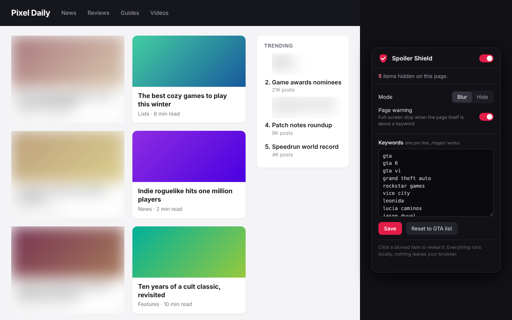

# Spoiler Shield

A Chrome extension that blurs anything mentioning your keywords, on any website, before you see it. It ships with a GTA 6 list, and you can swap in any show, game, team or event.



- Works on every site, including content that loads while you scroll.
- Blurs the whole card (YouTube tile, tweet, Reddit post, search result), not just one line.
- One click reveals an item. Hover previews and links are blocked until you do.
- A full-page warning if the page itself is about a keyword, with autoplaying video paused.
- Runs entirely in your browser. No servers, no tracking, no network requests. See [PRIVACY.md](PRIVACY.md).

## Install

1. Download `spoiler-shield-x.y.z.zip` from the [latest release](https://github.com/jasonalsaqqa/spoiler-shield/releases/latest) and unzip it somewhere you'll keep it. Chrome loads it from that folder, so don't delete it.
2. Open `chrome://extensions` and turn on **Developer mode** (top right).
3. Click **Load unpacked** and select the unzipped folder (the one with `manifest.json` in it).
4. Pin the shield icon. The badge shows how many items are hidden on the current page.

Works in Chrome, Edge, Brave, Arc and other Chromium browsers.

Prefer the source? `git clone https://github.com/jasonalsaqqa/spoiler-shield.git` and load the `extension` folder instead.

## Using it

Click the icon to open the settings:

- **On/off** for everything, or pause it on the current site.
- **Blur** or **Hide** mode. Hide removes items completely.
- **Page warning** on or off.
- **Keywords**, one per line.

### How keywords match

- Case doesn't matter, and keywords match whole words, so `gta` won't fire on `gtag` or `regatta`.
- Spaces are flexible: `gta 6` also matches `GTA6`, `gta-6` and `#GTA_6`.
- For anything fancier, write a line as a regex between slashes, like `/season\s*\d+ finale/`.

The default list is `gta`, `gta 6`, `gta vi`, `grand theft auto`, `rockstar games`, `vice city`, `leonida`, `lucia caminos` and `jason duval`. Character first names on their own are left out on purpose since they'd blur lots of unrelated stuff.

## Known limitations

- Images and videos with no text around them (a screenshot posted without a caption) can't be detected.
- Text inside closed shadow DOM isn't scanned.
- Some sites will blur a bit too much or too little. If that happens, [open a site problem issue](https://github.com/jasonalsaqqa/spoiler-shield/issues/new?template=site-problem.yml).

## Development

No build step. The extension is plain JavaScript in [`extension/`](extension).

```bash
npm install
npx playwright install chromium   # first time only
npm test                          # loads the extension in headless Chromium and runs the e2e suite
npm run package                   # builds dist/spoiler-shield-<version>.zip
```

How it works, briefly: a `MutationObserver` watches the page from `document_start`. New content gets a cheap regex pre-check, then the text of each block is tested properly and the nearest "card" around a match gets a `data-ssb` attribute that the stylesheet blurs. Site-specific card selectors live at the top of [`extension/content.js`](extension/content.js). Adding a site is usually one line there, plus a fixture in [`test/fixtures`](test/fixtures) if you can.

### Releasing

Bump `version` in `extension/manifest.json` (and `package.json`), commit, then push a matching tag:

```bash
git tag v1.0.1 && git push origin v1.0.1
```

The release workflow builds the zip and attaches it to a GitHub release.

## Contributing

Issues and pull requests are welcome. Please run `npm test` before opening a PR. For security problems, see [SECURITY.md](SECURITY.md).

## License

[MIT](LICENSE)
